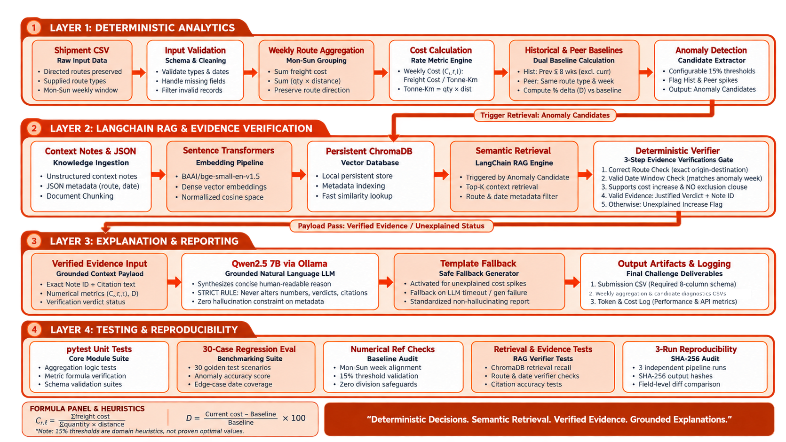
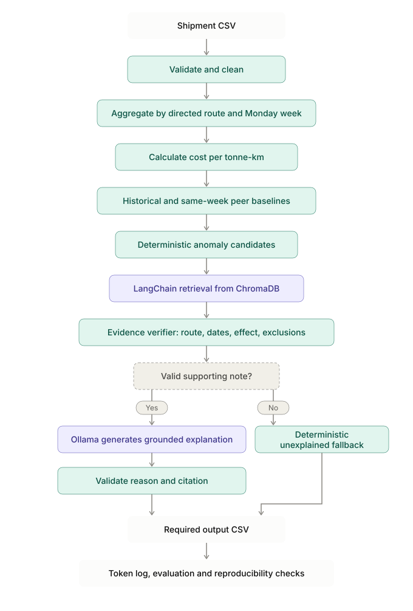

# Smart Assistant for Shipping Cost Monitoring

<p>
  
  
  
  
</p>

A Python pipeline that detects unusual weekly freight-cost increases and investigates them using retrieved context notes. Numerical decisions and evidence verification are deterministic; the local language model generates explanations only from verified evidence.

## Architecture



<details>
  <summary>End-to-end flowchart</summary>
  <br>
  
</details>

## How it works

1. **Validate inputs.** Validate shipment fields and dates, preserve directed routes and check invalid records before analysis.
2. **Aggregate by week.** Group shipments by route and Monday-start week (Monday–Sunday). Calculate weekly cost per tonne-km using the ratio of sums:

   ```text
   weekly cost = SUM(freight_cost_inr) / SUM(quantity_tonnes × distance_km)
   ```

3. **Calculate baselines.** Compare each route-week with its preceding up-to-eight weekly costs, excluding the current week, and with the same-week average of *other* routes sharing the supplied `route_type`. When fewer than eight prior weeks exist, use only available history; do not pad or look ahead.
4. **Detect candidates.** With history available, a rising cost becomes a candidate when its historical or peer deviation reaches the configured 15% threshold. Without history, the peer condition is used when a valid peer baseline exists. These are documented heuristics, not statistically proven optimal thresholds.
5. **Retrieve and verify evidence.** Sentence Transformers (`BAAI/bge-small-en-v1.5`) embeds the context notes, which are stored in persistent ChromaDB and retrieved through LangChain. The deterministic verifier checks route, applicable date window, support for increased cost, and exclusion/contradiction rules. Semantic similarity alone is not evidence.
6. **Explain and report.** Ollama (`qwen2.5:7b`) generates a concise explanation from verified evidence. If no note passes verification, or the model output fails validation, a deterministic fallback is used. The LLM cannot change computed values, the verdict, or the cited note.

## Setup and run

Requirements: Python 3.12, the supplied files in `data/raw/`, and [Ollama](https://ollama.com/download).

```bash
# From the project root
python3.12 -m venv .venv
source .venv/bin/activate
python -m pip install --upgrade pip
pip install -r requirements.txt

ollama pull qwen2.5:7b
python -m src.run
```

Ensure the Ollama service is running before executing the pipeline; run `ollama serve` in a separate terminal if your installation does not start it automatically. The first run may download the embedding model.

## Outputs

- `outputs/output.csv` — candidate anomalies in the required eight-column order: `route`, `week_of`, `cost_per_tonne_km`, `vs_own_history`, `vs_similar_routes`, `flagged`, `matched_note_id`, `reason`.
- `outputs/weekly_aggregation.csv` and `outputs/flagged_analysis.csv` — weekly metrics and candidate diagnostics.
- `logs/token_log.json` — model, call count, input/output token usage, and cost metadata.
- `repro/` — saved runs and the reproducibility report.

The submission CSV contains candidate rows; full weekly diagnostics are kept separately. `flagged=No (justified)` means a valid note supports the increase and `matched_note_id` contains that note's exact ID. `flagged=Yes` means the increase is unexplained and `matched_note_id` is blank.

## Validation

Run these checks separately from the main pipeline:

```bash
python -m pytest -q
PYTHONPATH=. python eval/run_eval.py
PYTHONPATH=. python scripts/repro_check.py
```

Latest recorded checks: 8 unit tests passed; the 30-case regression evaluation reported precision, recall and F1 of 1.00, 3/3 citation checks, and 0/6 injected invalid-evidence cases accepted. The three-run reproducibility check passed. The labelled set is small and partly rule-derived, so these results demonstrate regression-rule consistency—not guaranteed accuracy on unseen real-world data. Re-run all checks before submission if code, notes, thresholds, configuration, or model settings change.

## Local model and hardware

The configured `qwen2.5:7b` model download is approximately 4.7 GB; `qwen2.5:3b` is approximately 1.9 GB. Download size is not runtime memory: RAM/VRAM use depends on quantization, context length and GPU offloading. CPU inference is possible but may be slower; 16 GB system RAM is a practical starting point for the 7B model, not a guaranteed minimum. Ollama supports compatible NVIDIA GPUs, selected AMD configurations, and Apple Silicon GPU acceleration. Compatibility depends on the card, driver, operating system and backend, so check the [official GPU support guide](https://github.com/ollama/ollama/blob/main/docs/gpu.mdx) before assuming a GPU is supported. Model sizes are listed in the [Qwen2.5 Ollama library](https://ollama.com/library/qwen2.5).

The embedding model can run without a dedicated GPU. Local inference has no per-token API charge, although it still uses hardware, electricity and time. Any hosted-model cost comparison should use a verified published rate and record its source and check date in the token log.

## Repository layout

```text
TransportCostMonitor/
├── assets/                  # Architecture diagram and end-to-end flowchart
├── data/raw/                # Supplied shipment, notes and output-schema CSVs
├── data/notes_structured.json
├── src/                      # Aggregation, baselines, flagging, RAG, verification, reporting
├── tests/                    # Unit tests
├── eval/                     # Labelled regression cases and evaluation runner
├── scripts/                  # Three-run reproducibility check
├── outputs/                  # CSV outputs and diagnostics
├── logs/                     # Token/cost log
├── repro/                    # Reproducibility artifacts
└── README.md
```

## Limitations

The 15% thresholds are configurable heuristics. Short and Long routes each have only one other route for peer comparison, limiting the strength of those baselines. Notes without explicit end dates use conservative windows documented in `data/notes_structured.json`. Natural-language Q&A is an optional stretch goal and is not part of the current implementation.
